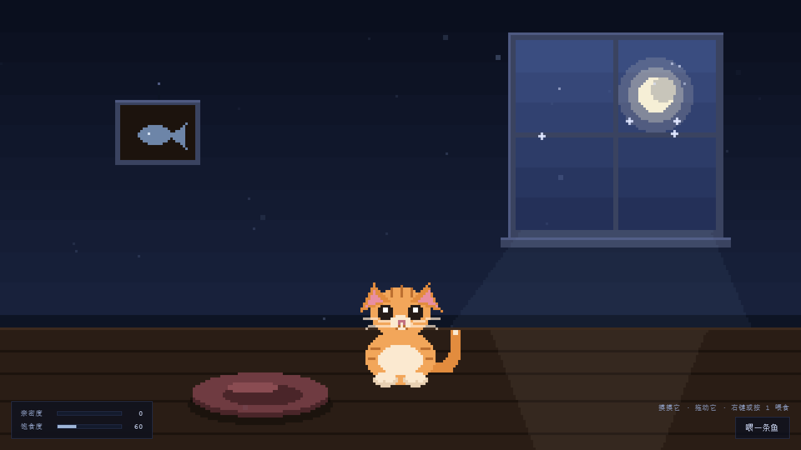

# 像素猫 · Web Desk Pet

一只住在浏览器窗口里的像素猫。它会看着你的鼠标，被你摸会开心，饿了要喂，深夜会犯困——而且它记得你。

纯静态、零依赖，打开网页就能玩。



---

## 能做什么

| 你做的 | 它的反应 |
|---|---|
| 移动鼠标 | 眼睛跟着你转 |
| 点它一下 | 眯眼笑、脸红、头顶冒爱心，亲密度 +3 |
| 按住拖动 | 被拎起来，四条腿乱蹬、尾巴下垂，松手掉回地面 |
| 右键 / 点按钮 / 按 `1` | 丢一条小鱼到地上，它会自己走过去吃掉 |
| 放着不管 | 发呆、东张西望、偶尔溜达两步；困了就蜷起来睡 |
| 深夜打开 | 22 点之后特别容易困，白天则精神得多 |
| 关掉再回来 | 记得上次的亲密度，但离线时间会换算成饥饿 |

状态会存在 `localStorage`，同一个浏览器下次打开还是同一只猫。

## 怎么做到不糊

画面是一块 **320 × 180** 的逻辑画布，显示时按整数倍放大，配合 `image-rendering: pixelated`，所以任何窗口尺寸下像素边缘都是硬的，不会出现模糊的缩放。

猫**没有图片资源**：耳朵是三角形、身体是椭圆、尾巴是二次贝塞尔曲线，全部用「像素化」版本的几何原语逐像素画出来。这样既没有版权问题，也能让尾巴和眼睛的动画随意变化而不用准备一堆帧图。

## 技术

- 纯静态：1 个 HTML、4 个 JS、1 个 CSS，**无依赖、无构建、无后端**
- 场景的静态部分（墙、地板、窗、挂画、坐垫）只在启动时绘制一次到离屏 canvas，每帧只叠加星星、灰尘、光束这些会动的东西
- 所有绘制走「扫描行」填充，每行只调一次 `fillRect`，小画布下稳定 60fps
- 用经典 `<script>` 标签而非 ES module，所以 `file://` 直接双击也能跑，不需要起服务器

## 本地运行

直接双击 `index.html` 就行。

想用服务器跑：

```bash
python -m http.server 8000
# 然后打开 http://localhost:8000
```

## 目录结构

```
web-desk-pet/
├── index.html              # 网页版骨架 + HUD
├── assets/
│   ├── css/style.css       # 画布居中、HUD 样式
│   ├── screenshot.png      # README 用截图
│   └── js/
│       ├── pixel.js        # 调色板 + 像素绘制原语（椭圆/三角/贝塞尔）
│       ├── scene.js        # 夜间房间：墙、地板、窗、月光、浮尘
│       ├── cat.js          # 猫的精灵绘制与状态机
│       └── main.js         # 主循环、输入、喂食、存档、HUD
├── desktop/                # Windows 桌面版
│   ├── DeskCat.cs          # 单文件 C# 源码（画布 + 精灵 + 状态机 + 窗口）
│   ├── DeskCat.exe         # 编译好的可执行文件
│   └── cat.ico             # 应用图标（5 个尺寸）
└── README.md
```

## 桌面版（Windows）

嫌开浏览器麻烦？`desktop/` 里是一个已编译好的 Windows 桌面版：一只真透明的猫常驻桌面，
猫身以外鼠标穿透，**不会挡住你点桌面图标**。

- 双击 `desktop/DeskCat.exe` 启动（或把它拖到桌面建快捷方式）
- **左键点一下**：摸它，会眯眼笑、冒爱心
- **按住拖动**：挪到屏幕任何位置，下次打开还在那儿
- **右键**：摸一摸 / 喂一条鱼 / 去睡觉 / 藏起来一分钟 / 退出
- 亲密度、饱食度、位置都存在 `%APPDATA%\DeskCat\state.txt`

只用 .NET Framework 自带的东西，**不需要装 Node、Python 或任何运行时**。

实现上踩过两个坑，记在这里免得重犯：

1. **透明**：最初用 `UpdateLayeredWindow` 逐帧推 32 位预乘位图，在本机始终显示不出来。
   最后换成 WinForms 的 `TransparencyKey` 颜色键（品红穿透）+ `WS_EX_LAYERED | WS_EX_TOPMOST`，
   稳定可靠。代价是没有半透明，所以特效都改成了不透明像素。
2. **DPI**：这台机器物理分辨率 2560×1600、系统缩放 175%，程序默认是 DPI-unaware，
   会被系统整体拉伸——既让像素猫发糊，窗口坐标也和真实屏幕对不上。
   在 `Main()` 第一行调用 `SetProcessDPIAware()`，并按实际 DPI 取整数倍缩放，两个问题一起解决。

自己编译（Windows 自带编译器，无需安装 VS）：

```bat
csc /target:winexe /codepage:65001 /optimize+ /win32icon:cat.ico ^
    /out:DeskCat.exe ^
    /reference:System.Windows.Forms.dll ^
    /reference:System.Drawing.dll ^
    DeskCat.cs
```

## 部署到 GitHub Pages

仓库的 `Settings → Pages`，Source 选 `Deploy from a branch`，分支 `main`、目录 `/ (root)`，保存后等 1~2 分钟即可访问：

```
https://<你的用户名>.github.io/web-desk-pet/
```

## License

MIT，见 [LICENSE](LICENSE)。

---

# Web Desk Pet (English)

A pixel cat that lives in your browser window. It follows your cursor with its eyes, purrs when you pet it, gets hungry, and falls asleep when it's late — and it remembers you between visits.

Pure static site: no dependencies, no build step, no backend. Double-click `index.html` and it runs.

- Your cursor moves → its eyes follow
- Click it → happy face, blush, hearts, affection +3
- Drag it → it dangles with flailing legs; release to drop it
- Right-click / button / press `1` → toss a fish, the cat walks over and eats it
- Leave it alone → idles, wanders, naps when sleepy
- State persists in `localStorage`, offline time converts to hunger

Rendered on a 320×180 logical canvas, upscaled by integer factors with `image-rendering: pixelated`. The cat has no image assets at all — every shape is a pixelated ellipse, triangle or Bézier curve drawn in code.
